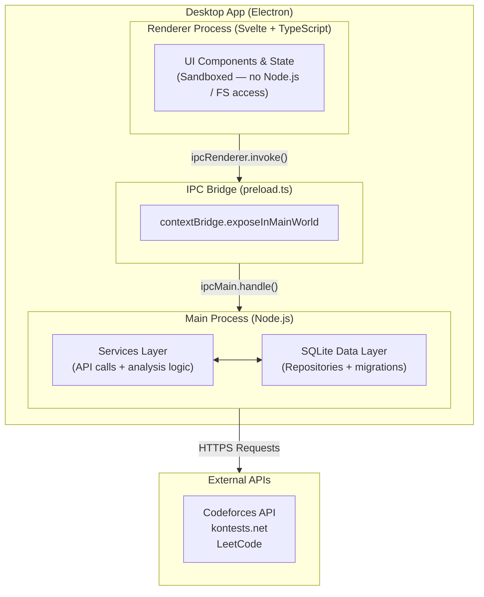

# Coders Note

A competitive programming assistant designed for contest tracking, profile analysis, and resource management. Built using Electron, Svelte, TypeScript, and SQLite.

## Overview

Coders Note is a desktop application intended to serve as a centralized tool for competitive programmers. It aggregates data across multiple platforms to provide scheduling, analytics, and resource management in a single interface.

### Core Capabilities
- **Contest Tracking:** View upcoming, running, and past contests from Codeforces, LeetCode, AtCoder, CodeChef, and other platforms, complete with local desktop notifications.
- **Profile Analytics:** Synchronize Codeforces profiles to view rating histories, verdict breakdowns, solve distributions by rating, and per-topic accuracy.
- **Topic Analysis:** Automatically detect weak and strong topics based on historical submission accuracy, with targeted resource suggestions.
- **Handle Comparison:** Compare two user handles side-by-side on any supported metric or topic.
- **Resource Management:** Browse a curated repository of articles, videos, and problem sets. Includes filtering by topic and difficulty, as well as bookmarking.
- **Problem Notes:** Maintain personal, persistently stored notes for specific problems.

### Planned Features
- Export analysis reports as PDF or CSV.
- Virtual contest mode for timed practice sets.
- Spaced-repetition review intervals for missed problems.
- Deep integration with LeetCode and AtCoder profiles.

## Languages & Technologies

- **Languages:** TypeScript, HTML, CSS, SQL
- **Core Frameworks:** Electron 30, Svelte 4, Node.js
- **Database:** SQLite (`better-sqlite3`)
- **Build & Tooling:** Vite (`electron-vite`), ESLint, Prettier
- **Testing:** Vitest (Unit), Playwright (E2E)

## Architecture

The application follows a standard secure Electron architecture, separating the privileged main process from the sandboxed renderer. This ensures high security by keeping the renderer isolated from the filesystem and Node.js environment.



### Security Principles
- **Context Isolation:** Enabled to prevent prototype pollution and other attacks.
- **Node Integration:** Disabled in the renderer to prevent unauthorized system access.
- **Privilege Separation:** Network and database calls are restricted entirely to the main process, accessed by the renderer only via strictly defined IPC channels.

## Project Structure

```text
coders_note/
├── electron/
│   ├── main.ts                  # Application entry point and window lifecycle
│   ├── preload.ts               # IPC bridge definition
│   ├── services/                # Business logic and external API integrations
│   ├── ipc/                     # IPC event handlers mapping to services
│   ├── db/                      # Database client, migrations, and repositories
│   └── utils/                   # HTTP client, logging, and caching utilities
├── src/
│   ├── main.ts                  # Renderer entry point
│   ├── App.svelte               # Root Svelte component
│   ├── routes/                  # View-level Svelte components
│   ├── components/              # Reusable UI components
│   ├── stores/                  # Reactive state management
│   └── styles/                  # Global CSS and design tokens
├── shared/
│   └── types.ts                 # Shared TypeScript interfaces
└── tests/
    ├── unit/                    # Vitest unit tests
    └── e2e/                     # Playwright integration tests
```

## Database Schema

Data is managed locally via SQLite (`better-sqlite3`). Schema changes are managed through numbered SQL migrations located in `electron/db/migrations/`.

- **handles:** Tracked user profiles per platform.
- **submissions:** Cached submission history.
- **submission_tags:** Normalized relations between submissions and topic tags.
- **rating_history:** Historical contest rating changes.
- **contests_cache:** Cached contest schedules.
- **reminders:** User-configured contest alerts.
- **resources:** Curated hub entries and references.
- **bookmarks:** User-saved resources.
- **notes:** User-authored problem notes.
- **weak_topics_cache:** Pre-computed analytics data.
- **settings:** Key-value store for application configuration.

*Note: All timestamps are stored internally as UTC Unix seconds and converted to local time during rendering.*

## Analytics Engine

The application performs automated topic analysis based on predefined algorithmic thresholds. These constants are strictly defined in `electron/services/analysis.service.ts` and ensure diagnostic consistency:

| Threshold Parameter | Value | Description |
|---|---|---|
| `MIN_ATTEMPTS` | **3** | Topics with fewer attempts are excluded from evaluation to prevent statistically insignificant results. |
| `WEAK_ACCURACY` | **< 40%** | Topics falling below this threshold are formally flagged as areas requiring study. |
| `STRONG_ACCURACY` | **≥ 80%** | Topics meeting or exceeding this threshold indicate high proficiency. |

## Configuration

Application configuration is stored persistently in the SQLite `settings` table and is dynamically managed through the user interface.

| Key | Default Value | Description |
|---|---|---|
| `theme` | `dark` | Visual theme preference (`dark`, `light`, or `system`). |
| `defaultHandle` | — | The primary handle used for automated dashboard loading. |
| `defaultPlatform` | `codeforces` | The primary competitive programming platform. |
| `notificationsEnabled` | `true` | Toggles local OS notifications for contests. |
| `reminderLeadMinutes` | `30` | The lead time interval for contest reminder dispatch. |
| `cacheRefreshIntervalMinutes` | `20` | Interval for polling and updating the background contest cache. |

## Getting Started

### Prerequisites
- Node.js 20.x or higher
- npm

### Installation

1. Clone the repository and install dependencies:
```bash
git clone https://github.com/your-username/coders_note.git
cd coders_note
npm install
```

2. Rebuild native modules. This step is strictly required to compile `better-sqlite3` against Electron's Node ABI:
```bash
npm run rebuild
```

### Development

To start the Vite development server and launch Electron in watch mode:
```bash
npm run dev
```

### Testing

```bash
# Run unit tests
npm test

# Run unit tests in watch mode
npm run test:watch
```

### Packaging

To build the application for production distribution:
```bash
npm run package
```
Output artifacts (e.g., `.exe`, `.dmg`, `.AppImage`) will be generated in the `release/` directory.


## External Integrations

- **Codeforces API:** Used for synchronizing user profiles, submissions, and rating histories. Must abide by official rate limits; the application respects the `status` field in API responses.
- **kontests.net API:** Used for aggregating cross-platform contest schedules. Isolated within a dedicated service layer to handle structural changes seamlessly.

*Note: External requests use a 10-second timeout with exponential backoff and are executed exclusively by the main process.*

## Contributing

Contributions are reviewed based on structural integrity and typing strictness. 

1. Fork the repository.
2. Create a feature branch (`git checkout -b feature/module-name`).
3. Commit your changes using Conventional Commits guidelines.
4. Open a Pull Request.

**Conventional Commits Specification:**
- `feat:` for additions.
- `fix:` for defect resolutions.
- `docs:` for documentation updates.
- `refactor:` for architectural restructuring without behavioral changes.
- `test:` for test additions or modifications.

## License

This project is licensed under the MIT License.
